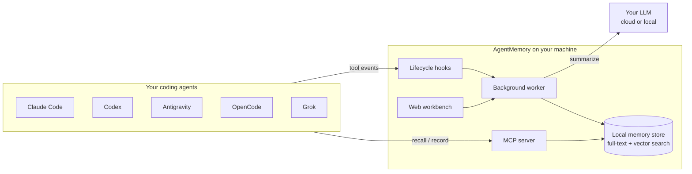

# AgentMemory

🌐 English | [中文](./README.zh.md)

**Shared long-term memory for your AI coding agents. Local-first, zero effort.**

[](#license)
[](https://nodejs.org/)
[](docs/Installation.md)


## Why

Every coding agent starts each session with amnesia. You explain the codebase again, rediscover the bug you already root-caused, retype the command that actually works. Switch from one agent to another and it is worse.

AgentMemory gives Claude Code, Codex, Antigravity, OpenCode and Grok one memory they all read and write. What one agent learned yesterday is waiting for the next one today, on your machine, with the LLM you choose.

## Highlights

- 🧠 **One memory, every agent.** Five agents share one store. Switch tools mid-project without starting over.
- ⚡ **Zero-effort capture.** Hooks record real tool work and summarize it in the background. No prompts to remember, no notes to write.
- 🔎 **Recall that finds the right thing.** Hybrid full-text and vector search, served to agents through MCP and at session start.
- 🗓️ **Daily digests.** A nightly summary per project: facts, decisions, verified commands, open questions, next steps.
- 🔒 **Yours, locally.** Memories stay on your machine, the workbench listens on loopback only, and you pick the LLM, cloud or fully local.
- 🖥️ **A real control room.** Browse, search and audit every memory, flip read/write switches and configure the LLM from one web workbench.
- ↩️ **Safe to try.** The installer backs up every file it touches, edits only its own entries and can put everything back with one command.

## Screenshots

| Memory | Digests & Reviews |
| --- | --- |
|  |  |
| **Projects** | **Settings** |
|  |  |

<sub>All screenshots show a demo instance with made-up data.</sub>

## Quick install

You need [Node.js](https://nodejs.org/) 22+ and Git.

**Windows**

```powershell
git clone https://github.com/KuanChen01/AgentMemory.git
cd AgentMemory
.\bootstrap-second-machine.cmd
```

**macOS / Linux**

```bash
git clone https://github.com/KuanChen01/AgentMemory.git && cd AgentMemory
npm install && npm run build
npm link --ignore-scripts
agentmem install
```

AgentMemory needs an OpenAI-compatible LLM endpoint to summarize what your agents do, cloud or local. On Windows, the first bootstrap run creates `~/.agentmem/.env` and stops so you can fill in the `AGENTMEM_LLM_*` values (or pass `-ApiKey`, `-ApiUrl` and `-Model`), then you run it again. On macOS and Linux, set the LLM in the workbench's **LLM Settings** or in `~/.agentmem/.env`.

Restart your agents when the install finishes, and open the workbench at <http://127.0.0.1:38888/admin> (on Windows: `.\start-workbench.cmd start`). From there you can switch the model or endpoint, replace the key and run a live connection test at any time.

All options, what the installer changes and how to undo it: see [Installation](docs/Installation.md).

## How it works



Hooks hand each tool event to a background worker, which summarizes it with your LLM and stores the result locally. Agents read memory back through MCP and their session-start hooks. Everything fails open: if the worker is down, your agent keeps working.

## Documentation

- [Installation](docs/Installation.md): Windows bootstrap, other platforms, LLM setup, options, what gets changed and how to undo it
- [Full reference](docs/Reference.md): configuration, CLI, admin APIs, runtime policy, per-agent details
- [LLM cost controls](docs/LLM%20Cost%20Controls.md) · [Native SQLite migration](docs/Native%20SQLite%20Migration.md)
- [Second machine bootstrap guide (中文)](docs/Second%20Machine%20Bootstrap%20Guide.zh.md)
- [Release process](docs/Release%20Process.md) · [Changelog](CHANGELOG.md)

## License

Apache-2.0
