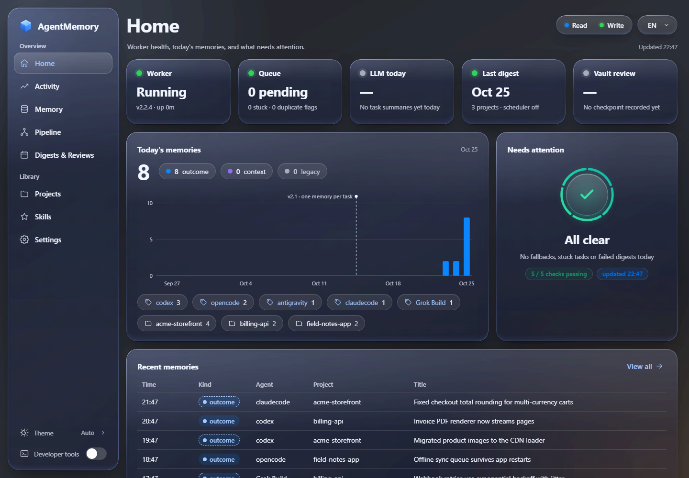
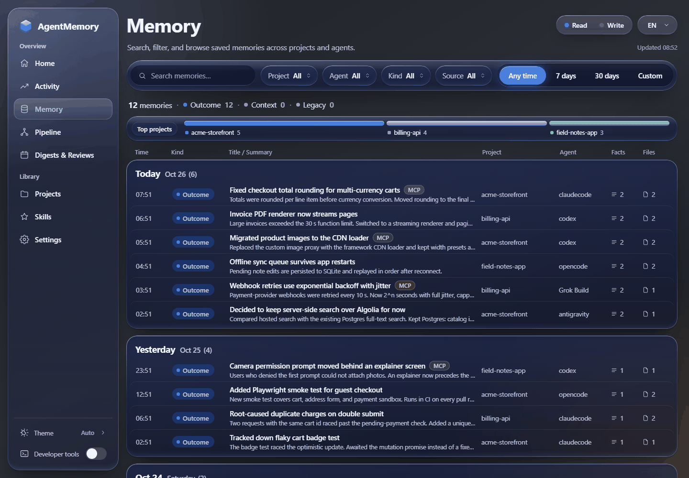
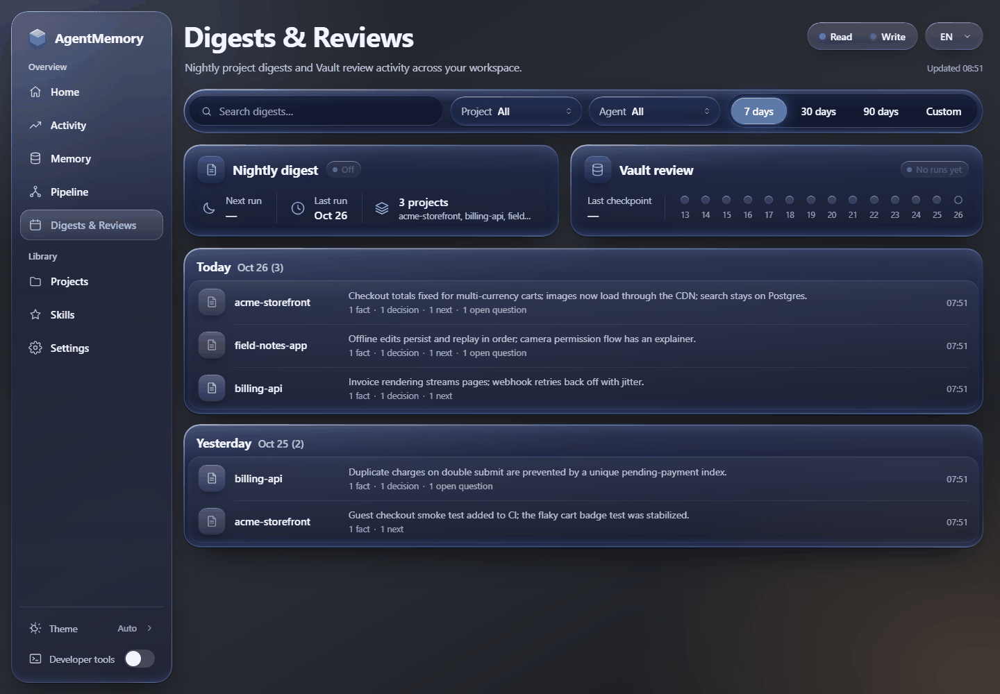
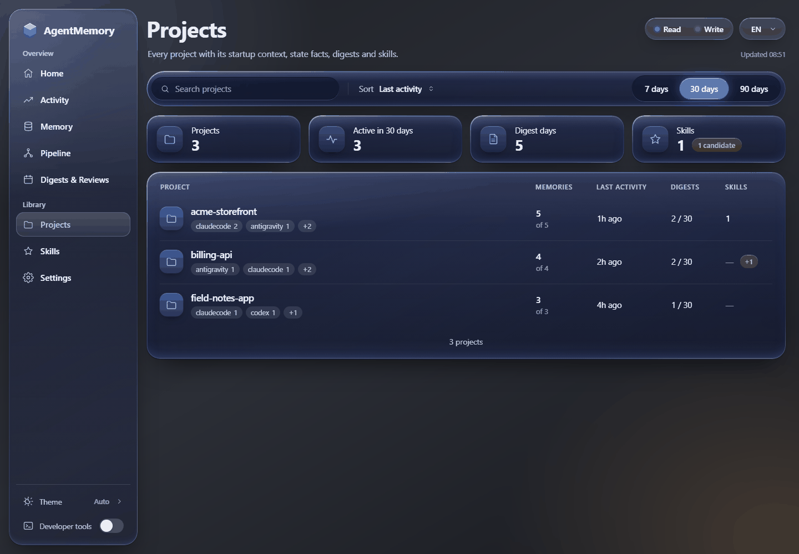
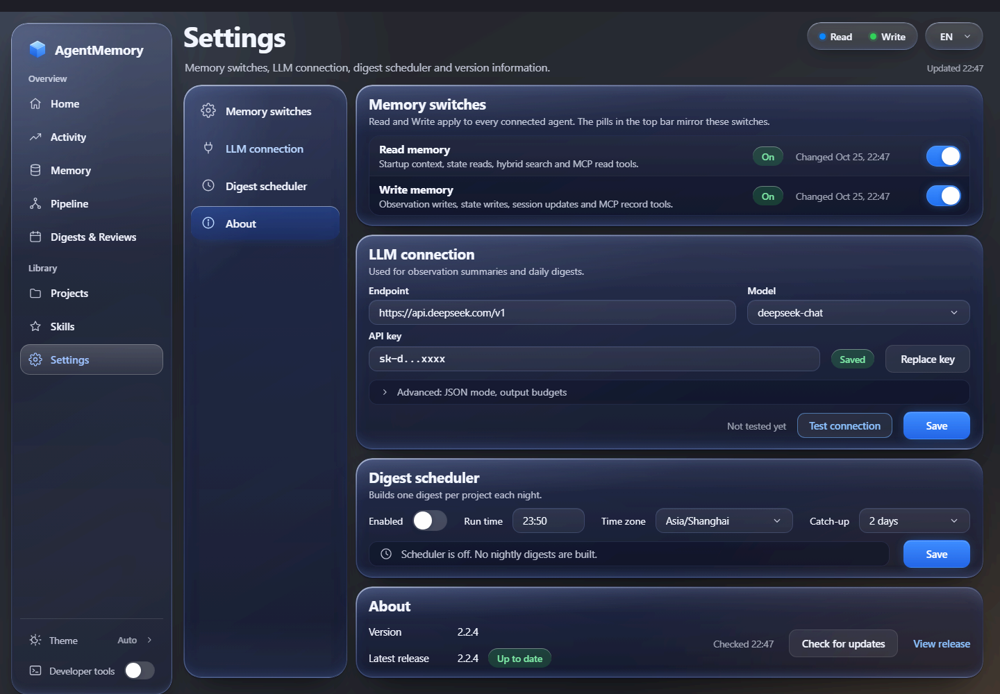
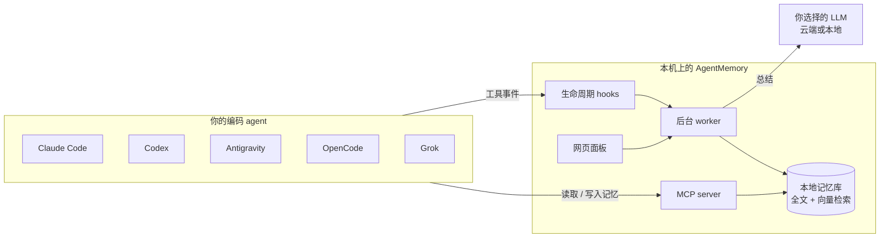

# AgentMemory

🌐 [English](./README.md) | 中文

**给你所有 AI 编码 agent 的共享长期记忆。本地优先，零负担。**

[](#许可证)
[](https://nodejs.org/)
[](docs/Installation.zh.md)




## 为什么需要它

编码 agent 每开一个新会话都会“失忆”：代码库要重新解释一遍，查清楚过的 bug 要再查一遍，真正能跑通的命令要再试一遍。换一个 agent，情况更糟。

AgentMemory 让 Claude Code、Codex、Antigravity、OpenCode、Grok 读写同一份记忆。昨天某个 agent 学到的东西，今天换一个 agent 也能直接用上；数据留在你自己的电脑上，LLM 由你来选。

## 亮点

- 🧠 **一份记忆，所有 agent 共享**：五个 agent 共用一个存储，项目中途换工具也不用从头来。
- ⚡ **零负担记录**：hooks 自动记录真实的工具调用，后台完成总结；不用记提示词，也不用写笔记。
- 🔎 **找得准**：全文检索 + 向量检索混合召回，通过 MCP 和会话启动时的上下文提供给 agent。
- 🗓️ **每日总结**：每个项目每晚一份总结，包含事实、决策、已验证命令、未决问题和下一步。
- 🔒 **数据在你手里**：记忆保存在本机的数据库里，管理面板只响应本机发来的请求，LLM 可以用云端服务，也可以完全本地。
- 🖥️ **可视化控制台**：在一个网页面板里浏览、搜索、审计每条记忆，切换读写开关，配置 LLM。
- ↩️ **放心试用**：安装器改动前先备份每个文件，只修改自己的条目，一条命令就能全部还原。

## 截图

| 记忆 | 每日总结与审查 |
| --- | --- |
|  |  |
| **项目** | **设置** |
|  |  |

<sub>所有截图都来自灌入虚构数据的演示实例。</sub>

## 快速安装

需要 [Node.js](https://nodejs.org/) 22+ 和 Git。

**Windows**

```powershell
git clone https://github.com/KuanChen01/AgentMemory.git
cd AgentMemory
.\bootstrap-second-machine.cmd
```

**macOS / Linux（少量测试）**

```bash
git clone https://github.com/KuanChen01/AgentMemory.git && cd AgentMemory
npm install && npm run build
npm link --ignore-scripts
agentmem install
```

AgentMemory 需要一个 OpenAI 兼容的 LLM 接口来总结 agent 的工作，云端或本地都可以。Windows 上第一次运行 bootstrap 会生成 `~/.agentmem/.env` 并停下来，填好其中的 `AGENTMEM_LLM_*` 后再运行一次即可（也可以直接传 `-ApiKey`、`-ApiUrl`、`-Model`）。macOS / Linux 上可以在面板的 **LLM 设置**里配置，或者直接编辑 `~/.agentmem/.env`。

装好后重启各个 agent，在 <http://127.0.0.1:38888/admin> 打开面板（Windows 上也可以运行 `.\start-workbench.cmd start`）。之后随时可以在面板里切换模型或接口地址、更换 key，并做一次实时连接测试。

全部参数、安装器会改动什么、怎么还原，详见[安装说明](docs/Installation.zh.md)。

## 工作原理



Hooks 把每个工具事件交给后台 worker，worker 用你选择的 LLM 做总结并保存在本地。Agent 通过 MCP 和会话启动 hooks 读回记忆。任何环节出问题都不会阻塞：worker 没启动时，agent 照常工作。

## 文档

- [安装说明](docs/Installation.zh.md)：Windows bootstrap、其他平台、LLM 配置、参数、会改动哪些文件以及如何还原
- [完整参考文档](docs/Reference.zh.md) · [Full reference (English)](docs/Reference.md)
- [第二台电脑 Bootstrap 教程](docs/Second%20Machine%20Bootstrap%20Guide.zh.md)
- [LLM 成本控制](docs/LLM%20Cost%20Controls.md) · [原生 SQLite 迁移](docs/Native%20SQLite%20Migration.md)
- [发布流程](docs/Release%20Process.md) · [审核后更新](docs/Reviewed%20Updates.zh.md) · [更新日志](CHANGELOG.md)

## 许可证

Apache-2.0
